# TASK 2: Agile Planning & DevOps Lifecycle

## 1. Agile Methodology & User Stories

### Epics & User Stories
- **EPIC-1: Passenger Experience**
  - **US-101:** *As a Passenger*, I want to create a ride request with pickup, drop-off, date/time, vehicle type, and seats, so that I can commute easily.
    - *Acceptance Criteria:* Form validates all fields; calculated fare is populated; initial state is `REQUESTED`; audit log entry created.
  - **US-102:** *As a Passenger*, I want to view my ride status and timeline, so that I know when a driver accepts and arrives.
    - *Acceptance Criteria:* Dynamic timeline visualization updates from `REQUESTED` to `COMPLETED`; cancellations allowed before `ONGOING`.
  - **US-103:** *As a Passenger*, I want smart recommendations for compatible rides, so that I can carpool or save costs.
    - *Acceptance Criteria:* Matching engine evaluates route proximity and schedule overlap; displayed on passenger hub.

- **EPIC-2: Driver Operations**
  - **US-201:** *As a Driver*, I want to view all open ride requests in real-time, so that I can choose trips that match my location.
    - *Acceptance Criteria:* Ride list shows passenger name, source, destination, seats, and fare; filterable by status `REQUESTED`.
  - **US-202:** *As a Driver*, I want to accept a ride and progress its status (`DRIVER_ASSIGNED` → `ONGOING` → `COMPLETED`), so that the passenger receives accurate updates.
    - *Acceptance Criteria:* Status transitions are recorded with timestamp and driver metadata; invalid state changes are rejected.

- **EPIC-3: Fleet Administration & Analytics**
  - **US-301:** *As an Administrator*, I want an overview dashboard displaying aggregate ride metrics, so that I can evaluate platform health.
    - *Acceptance Criteria:* Real-time counters for Total Rides, Active Rides, Completed Rides, Cancellations, and Seat Utilization Rate.
  - **US-302:** *As an Administrator*, I want to filter rides by status, search by keywords, and audit ride event histories, so that I can troubleshoot disputes.
    - *Acceptance Criteria:* Interactive table with search-as-you-type and modal inspection of ride timeline.

---

## 2. Sprint Backlog & Kanban Workflow

### Sprint Schedule (2-Week Iteration Breakdown)
```
[ Backlog ] ──► [ Sprint Planning ] ──► [ In Progress ] ──► [ Code Review / PR ] ──► [ CI / Test ] ──► [ Done ]
```

| Work Item ID | Title | Estimation (SP) | Priority | Assigned Sprint |
| :--- | :--- | :--- | :--- | :--- |
| **SPR-01** | Domain Model & H2/PostgreSQL Repository Setup | 3 | High | Sprint 1 |
| **SPR-02** | Core Ride Service & Validation Logic | 5 | High | Sprint 1 |
| **SPR-03** | Passenger & Driver Interactive Web UI (Thymeleaf/Vanilla CSS) | 5 | High | Sprint 1 |
| **SPR-04** | Admin Analytics Dashboard & Audit Logging | 3 | Medium | Sprint 1 |
| **SPR-05** | Smart Recommendation Engine | 3 | Medium | Sprint 1 |
| **SPR-06** | Selenium WebDriver UI Journey Test Suite | 5 | High | Sprint 2 |
| **SPR-07** | Jenkins CI/CD Pipeline as Code (Jenkinsfile) | 5 | High | Sprint 2 |
| **SPR-08** | Docker Multi-Stage Packaging & Compose Setup | 3 | High | Sprint 2 |
| **SPR-09** | Ansible Idempotent Node Provisioning & Rollback | 5 | Medium | Sprint 2 |

---

## 3. Definition of Done (DoD)
A story or increment is considered **Done** only when:
1. Feature implementation satisfies all functional and non-functional Acceptance Criteria.
2. Clean code standards met: zero compile errors, no deprecated APIs, formatted code.
3. Unit and integration test coverage implemented with JUnit 5 & AssertJ; `mvn test` passes 100%.
4. Selenium end-to-end user journey tests pass in headless mode.
5. Jenkins declarative pipeline builds, tests, packages, and verifies artifact creation.
6. Docker image builds cleanly and runs with healthy actuator response.
7. Git feature branch merged into main through documented Pull Request workflow.

---

## 4. DevOps Lifecycle Architecture

```mermaid
flowchart LR
    subgraph Dev ["1. Plan & Code"]
        A[Git Local Feature Branch] --> B[Commit & Push]
    end

    subgraph CI ["2. Continuous Integration"]
        B --> C[GitHub / Git Remote]
        C --> D[Jenkins CI Webhook / Polling]
        D --> E[Maven Build & Unit Tests]
        E --> F[Selenium Automated UI Tests]
        F --> G[Package WAR / JAR Artifact]
    end

    subgraph CD ["3. Continuous Delivery & Deployment"]
        G --> H[Docker Multi-stage Build & Tag]
        H --> I[Ansible Provisioning / Target Node]
        I --> J[Container / Tomcat Launch]
    end

    subgraph Monitor ["4. Continuous Monitoring"]
        J --> K[Health Check /actuator/health]
        K --> L[Dashboard & Operational Metrics]
        K -.->|Failure Detected| M[Automated Rollback Playbook]
    end
```


