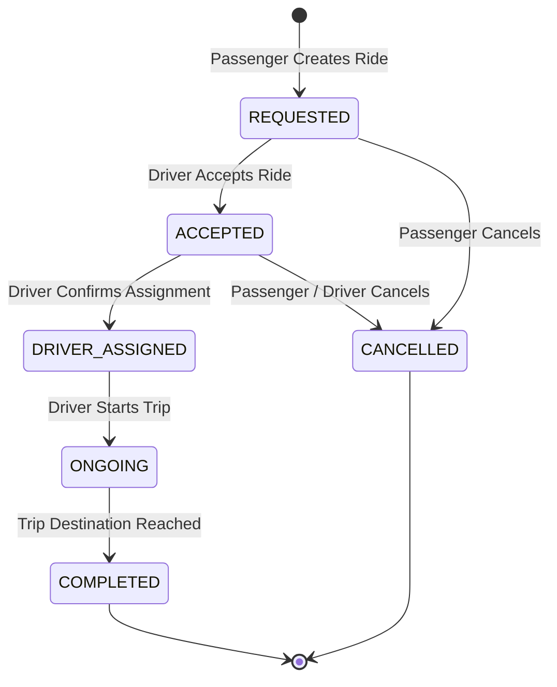

# TASK 3: Software Requirements Specification & Architecture

## 1. System Architecture
SmartRide is architected as a modular Spring Boot 3 web application using a layered architectural model:
- **Presentation Layer:** Server-side rendered responsive Thymeleaf templates with Vanilla CSS (Dark/Modern theme, Glassmorphism, animations) and vanilla JavaScript for dynamic client-side filtering and real-time status updates.
- **REST / Web Controller Layer:** `RideWebController` (UI routes), `RideApiController` (REST endpoints), and `AdminApiController` (dashboard statistics & metrics).
- **Service Layer:** `RideService`, `SmartRecommendationService`, `AuditService`, `MetricsService`.
- **Data Access Layer:** Spring Data JPA with `RideRepository` and `RideAuditLogRepository`.
- **Persistence Layer:** In-memory H2 database (`jdbc:h2:mem:smartridedb`) with production PostgreSQL configuration profile available (`application-prod.properties`).

```
+-------------------------------------------------------------------------------+
|                             Client Browser UI                                 |
|            (HTML5 / Vanilla CSS Design System / JavaScript Fetch)             |
+-------------------------------------------------------------------------------+
                                      │ HTTP (Port 8080)
                                      ▼
+-------------------------------------------------------------------------------+
|                       Spring Boot Application (SmartRide)                     |
|                                                                               |
|  +-------------------------------------------------------------------------+  |
|  | Controller Layer                                                        |  |
|  |  • RideWebController (UI Pages)       • RideApiController (REST Endpoints) |
|  |  • AdminApiController (Metrics)       • HealthCheckController           |  |
|  +-------------------------------------------------------------------------+  |
|                                      │                                        |
|  +-------------------------------------------------------------------------+  |
|  | Service Layer (Business Logic)                                          |  |
|  |  • RideService                        • SmartRecommendationService      |  |
|  |  • AuditLogService                    • DashboardMetricsService         |  |
|  +-------------------------------------------------------------------------+  |
|                                      │                                        |
|  +-------------------------------------------------------------------------+  |
|  | Data Access & Domain Model                                              |  |
|  |  • Ride Entity & Repository           • RideAuditLog Entity & Repository|  |
|  |  • RideStatus State Machine           • VehicleType & Enums             |  |
|  +-------------------------------------------------------------------------+  |
+-------------------------------------------------------------------------------+
                                      │ JPA / JDBC
                                      ▼
+-------------------------------------------------------------------------------+
|                       Database Engine (H2 / PostgreSQL)                       |
+-------------------------------------------------------------------------------+
```

---

## 2. Ride Lifecycle State Machine



---

## 3. Data Model (Entity-Relationship)

### `Ride` Entity
- `id` (Long, PK, Auto-increment)
- `passengerName` (String, Not Null)
- `passengerPhone` (String, Not Null)
- `sourceLocation` (String, Not Null)
- `destinationLocation` (String, Not Null)
- `departureTime` (LocalDateTime, Not Null)
- `requestedSeats` (Integer, Min=1, Max=6)
- `vehicleType` (Enum: `SEDAN`, `SUV`, `HATCHBACK`, `ELECTRIC_PREMIUM`)
- `estimatedFare` (BigDecimal, Not Null)
- `driverName` (String, Nullable)
- `driverVehicleNumber` (String, Nullable)
- `status` (Enum: `REQUESTED`, `ACCEPTED`, `DRIVER_ASSIGNED`, `ONGOING`, `COMPLETED`, `CANCELLED`)
- `createdAt` (LocalDateTime)
- `updatedAt` (LocalDateTime)

### `RideAuditLog` Entity
- `id` (Long, PK, Auto-increment)
- `rideId` (Long, FK to Ride)
- `previousStatus` (Enum RideStatus)
- `newStatus` (Enum RideStatus)
- `actorRole` (String: `PASSENGER`, `DRIVER`, `ADMIN`, `SYSTEM`)
- `actorName` (String)
- `notes` (String)
- `timestamp` (LocalDateTime)

---

## 4. REST API Endpoint Specifications

| Method | Endpoint | Description | Request Body / Params | Response |
| :--- | :--- | :--- | :--- | :--- |
| `GET` | `/api/rides` | List all rides with optional filter | `?status=REQUESTED&source=Downtown` | `200 OK` (JSON Array of Rides) |
| `GET` | `/api/rides/{id}` | Get specific ride details + audit trail | Path Variable `id` | `200 OK` (RideDTO with AuditLogs) |
| `POST` | `/api/rides` | Create a new ride request | `CreateRideRequest` (JSON) | `201 Created` (RideDTO) |
| `PUT` | `/api/rides/{id}/status` | Transition ride state | `UpdateStatusRequest` (`newStatus`, `actorRole`, `driverName`) | `200 OK` (Updated RideDTO) |
| `GET` | `/api/rides/recommendations` | Get smart recommended rides | `?source=Airport&destination=Central` | `200 OK` (List of matched rides) |
| `GET` | `/api/admin/metrics` | Aggregate platform statistics | None | `200 OK` (Total, Active, Completed, Cancelled, Utilization) |
| `GET` | `/actuator/health` | Spring Boot Actuator Health | None | `200 OK` (`{"status":"UP"}`) |
| `GET` | `/api/health` | Application health ping | None | `200 OK` (`{"status":"HEALTHY","timestamp":"..."}`) |
