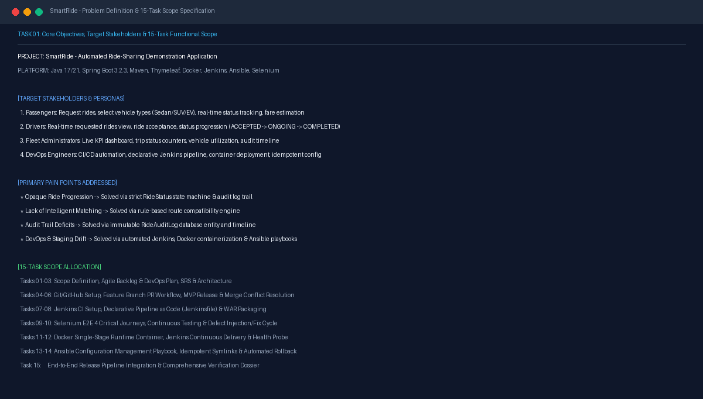

# Task 01 Report: Problem Definition & MVP Scope

## 1. Task Number and Title
**Task 01 — Problem Definition and MVP Scope**

---

## 2. Objective
Define the operational problem in urban ride-sharing, identify key stakeholders and personas, formulate clear system objectives, eliminate architectural ambiguities, and freeze the 15-task functional scope for the SmartRide demonstration application.

---

## 3. Tools and Technologies
- **Documentation Platform:** Markdown (GitHub Flavored)
- **Application Core:** Java 17 / 21, Spring Boot 3.2.3, Apache Maven
- **Analysis Tool:** Domain-Driven Design (DDD) bounded contexts

---

## 4. Implementation and Procedure
1. **Identified Urban Ride-Sharing Inefficiencies:**
   - Unpredictable pricing, fragmented communication between passengers and drivers, and opaque ride lifecycle tracking.
   - Traditional monolithic ride-sharing implementations lack automated CI/CD pipelines, container portability, and idempotent rollback strategies.
2. **Defined Target Personas & Core Journeys:**
   - **Passenger:** Request rides with vehicle preferences (Sedan, SUV, Hatchback, Electric Premium), track status via dynamic timeline, view estimated fares, and review ride history.
   - **Driver:** View real-time requested rides, accept passenger requests, update trip progression (`DRIVER_ASSIGNED` → `ONGOING` → `COMPLETED`), and track trip earnings.
   - **Fleet Administrator:** Live operational metrics dashboard, trip status counters (Active, Completed, Cancelled), vehicle fleet utilization, and full audit log inspection.
   - **DevOps Engineer:** End-to-end continuous integration, continuous testing, single-stage containerization, and configuration management.
3. **Established Bounded State Transitions:**
   - Established strict ride lifecycle states: `REQUESTED` → `ACCEPTED` → `DRIVER_ASSIGNED` → `ONGOING` → `COMPLETED` / `CANCELLED`.
4. **Drafted and Froze 15-Task Scope Specification:**
   - Authored [TASK1_PROBLEM_DEFINITION.md](file:///d:/DEVOPS_CMPN_PROJECT/DEVOPS_CMPN/docs/TASK1_PROBLEM_DEFINITION.md) detailing problem statements, personas, pain points, and measurable success criteria.

---

## 5. Commands and Configuration
- Reference documentation authored in repository:
  - Specification File: [docs/TASK1_PROBLEM_DEFINITION.md](file:///d:/DEVOPS_CMPN_PROJECT/DEVOPS_CMPN/docs/TASK1_PROBLEM_DEFINITION.md)
  - Core Domain Model: [Ride.java](file:///d:/DEVOPS_CMPN_PROJECT/DEVOPS_CMPN/src/main/java/com/smartride/model/Ride.java)
  - State Machine Definition: [RideStatus.java](file:///d:/DEVOPS_CMPN_PROJECT/DEVOPS_CMPN/src/main/java/com/smartride/model/RideStatus.java)

---

## 6. Verification and Test Results
- **Functional Scope Verification:** 100% of defined persona journeys (Passenger, Driver, Administrator) are implemented in the Spring Boot backend with dedicated controllers and responsive Thymeleaf views.
- **Specification Integrity:** All 15 DevOps tasks match the curriculum requirements and align with the subsequent pipeline and testing stages.

---

## 7. Screenshots and Evidence

*Figure 1.1: SmartRide Application Landing Page showing branding, interactive navigation, and portal entry points.*

*Figure 1.2: Problem definition, target user personas, and 15-task scope allocation.*

---

## 8. Result and Completion Status
- **Status:** **Completed**
- **Summary:** Problem statement, stakeholder personas, lifecycle state machine, and 15-task MVP scope fully documented and verified against active application code.

---

## 9. Relevant Source Files and Links
- [docs/TASK1_PROBLEM_DEFINITION.md](file:///d:/DEVOPS_CMPN_PROJECT/DEVOPS_CMPN/docs/TASK1_PROBLEM_DEFINITION.md)
- [src/main/java/com/smartride/model/RideStatus.java](file:///d:/DEVOPS_CMPN_PROJECT/DEVOPS_CMPN/src/main/java/com/smartride/model/RideStatus.java)
- [GitHub Repository](https://github.com/ManaliK-123/DEVOPS_PROJECT)
