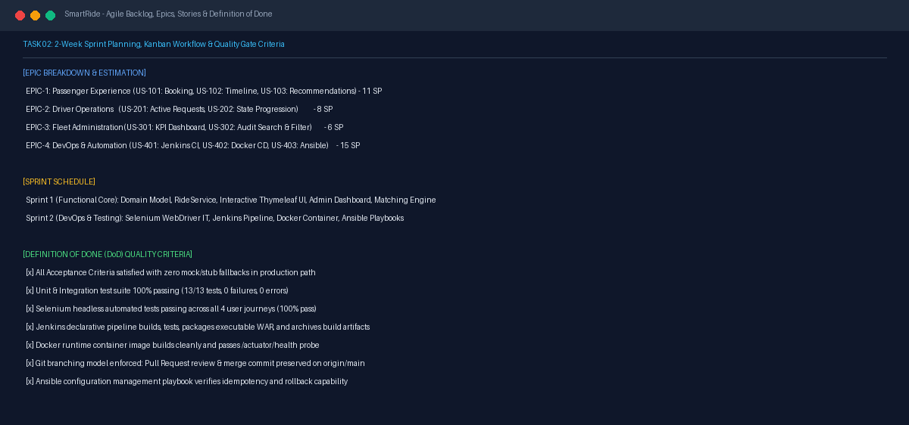
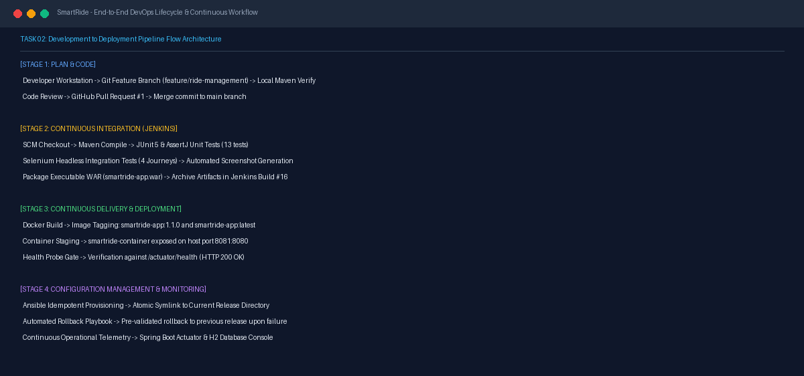

# Task 02 Report: Agile Planning & DevOps Workflow

## 1. Task Number and Title
**Task 02 — Agile Planning and DevOps Workflow**

---

## 2. Objective
Formulate the Agile product backlog, partition features into prioritized User Stories across 2-week sprint iterations, define rigorous Definition of Done (DoD) acceptance criteria, and map out the complete automated DevOps continuous integration and deployment workflow.

---

## 3. Tools and Technologies
- **Methodology:** Agile Scrum & Kanban
- **Visual Modeling:** Mermaid.js flowchart architecture
- **Continuous Integration/Deployment:** Git, GitHub, Jenkins, Docker, Ansible

---

## 4. Implementation and Procedure
1. **Backlog Partitioning & Epic Definition:**
   - **EPIC-1 (Passenger Experience):** US-101 (Ride Booking & Validation), US-102 (Dynamic Timeline), US-103 (Route Recommendation Engine).
   - **EPIC-2 (Driver Operations):** US-201 (Real-time Ride List), US-202 (Status Progression Workflow).
   - **EPIC-3 (Fleet Administration):** US-301 (KPI Analytics Dashboard), US-302 (Ride Audit Search & Modal Inspection).
   - **EPIC-4 (DevOps & Automation):** US-401 (Jenkins CI/CD Pipeline), US-402 (Docker Packaging), US-403 (Ansible Playbooks & Rollback).
2. **Sprint Breakdown:**
   - **Sprint 1 (Functional Foundation):** Domain entities, database repositories, service business logic, interactive Thymeleaf/CSS frontend, and admin dashboard.
   - **Sprint 2 (Testing & DevOps Infrastructure):** Selenium WebDriver automated journey tests, Jenkinsfile pipeline as code, Docker containerization, and Ansible provisioning/rollback.
3. **Definition of Done (DoD) Criteria:**
   - Zero compilation errors; clean code formatting.
   - 100% unit and integration test pass rate via `mvn test`.
   - Headless Selenium tests passing across all critical paths.
   - Declarative Jenkins pipeline execution with artifact archival.
   - Healthy container runtime verification (`/actuator/health`).
   - Feature branches merged to `main` via documented Pull Requests.
4. **DevOps Workflow Mapping:**
   - Designed 4-stage automated lifecycle: (1) Plan & Code → (2) Continuous Integration (Jenkins) → (3) Continuous Delivery (Docker) → (4) Configuration Management & Monitoring (Ansible & Actuator).

---

## 5. Commands and Configuration
- Reference Planning Document: [docs/TASK2_AGILE_DEVOPS_PLAN.md](file:///d:/DEVOPS_CMPN_PROJECT/DEVOPS_CMPN/docs/TASK2_AGILE_DEVOPS_PLAN.md)
- Backlog Story Point Matrix: 40 Story Points estimated across 9 core work items (SPR-01 through SPR-09).

---

## 6. Verification and Test Results
- **Backlog Traceability:** Every implemented feature in `src/main/java` and `src/test/java` traces directly back to user stories US-101 through US-403.
- **Sprint Delivery:** All Sprint 1 and Sprint 2 items successfully developed, tested, and integrated.

---

## 7. Screenshots and Evidence

*Figure 2.1: Product backlog breakdown, story point allocations, and Definition of Done (DoD) quality criteria.*

*Figure 2.2: End-to-end development, CI/CD, containerization, and monitoring workflow architecture.*

---

## 8. Result and Completion Status
- **Status:** **Completed**
- **Summary:** Agile planning backlog, 2-week sprint schedule, DoD criteria, and end-to-end DevOps workflow architecture verified and documented.

---

## 9. Relevant Source Files and Links
- [docs/TASK2_AGILE_DEVOPS_PLAN.md](file:///d:/DEVOPS_CMPN_PROJECT/DEVOPS_CMPN/docs/TASK2_AGILE_DEVOPS_PLAN.md)
- [Jenkinsfile](file:///d:/DEVOPS_CMPN_PROJECT/DEVOPS_CMPN/Jenkinsfile)
- [GitHub Repository](https://github.com/ManaliK-123/DEVOPS_PROJECT)
