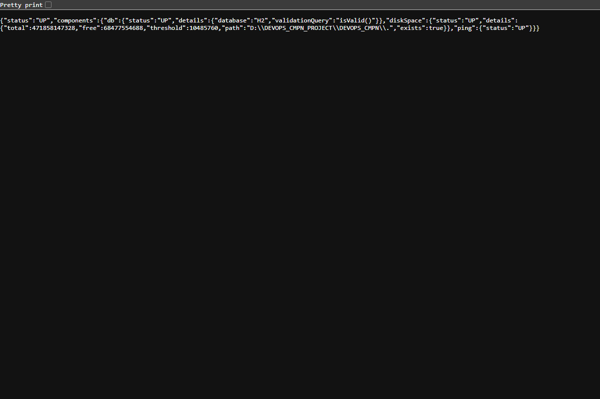
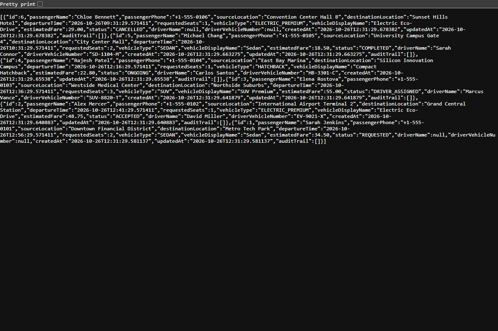
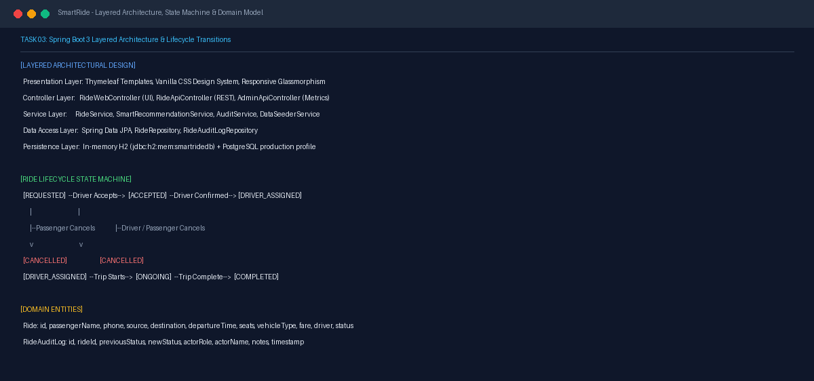

# Task 03 Report: Requirements, Architecture, Data Model, and Setup

## 1. Task Number and Title
**Task 03 — Requirements, Architecture, Data Model, and Setup**

---

## 2. Objective
Formulate the Software Requirements Specification (SRS), define the multi-tier Spring Boot system architecture, model domain entities and state machine transitions, document REST API contracts, and provide verified local setup instructions.

---

## 3. Tools and Technologies
- **Application Framework:** Spring Boot 3.2.3 (Java 17/21)
- **Persistence & ORM:** Spring Data JPA, Hibernate, In-memory H2 database, PostgreSQL profile
- **Web & Templates:** Spring Web MVC, Thymeleaf, Vanilla CSS, Fetch API
- **Monitoring & Telemetry:** Spring Boot Actuator

---

## 4. Implementation and Procedure
1. **Designed Layered System Architecture:**
   - **Presentation Layer:** Responsive HTML5 templates styled with custom Vanilla CSS featuring dark glassmorphic styling, micro-animations, and dynamic vanilla JavaScript fetch calls.
   - **Controller Layer:** `RideWebController` for UI routing; `RideApiController` for JSON REST endpoints; `AdminApiController` for fleet KPIs; `HealthCheckController` for ping endpoints.
   - **Service Layer:** `RideService` (ride business rules and state validation), `SmartRecommendationService` (route overlap scoring), `AuditService` (immutable event logging).
   - **Data Access & Persistence:** Spring Data JPA repositories backed by an in-memory H2 database (`jdbc:h2:mem:smartridedb`) with a production-ready PostgreSQL profile.
2. **Defined State Machine & Transition Rules:**
   - Enforced allowed lifecycle progression: `REQUESTED` → `ACCEPTED` → `DRIVER_ASSIGNED` → `ONGOING` → `COMPLETED`.
   - Prevented illegal transitions (e.g., jumping from `REQUESTED` directly to `COMPLETED` or modifying a `CANCELLED` ride) via custom `InvalidStateTransitionException`.
3. **Structured Entity-Relationship Model:**
   - **`Ride` Entity:** Primary key `id`, passenger contact details, source/destination coordinates, departure timestamp, requested seats, vehicle type enum, estimated fare, driver details, and current status.
   - **`RideAuditLog` Entity:** Tracks `rideId`, `previousStatus`, `newStatus`, `actorRole`, `actorName`, `notes`, and audit timestamp.
4. **Local Setup & Actuator Verification:**
   - Verified that running `mvn clean package` and launching the executable archive produces active endpoints on port 8080/8081.

---

## 5. Commands and Configuration
- **Run Application Locally:**
  ```powershell
  mvn clean test
  mvn package -DskipTests
  java -jar target/smartride-app.war --server.port=8081
  ```
- **Health & API Verification Commands:**
  ```powershell
  curl.exe -s http://localhost:8081/actuator/health
  curl.exe -s http://localhost:8081/api/rides
  ```

---

## 6. Verification and Test Results
- **Actuator Health Endpoint:** Returned HTTP 200 OK with `{"status":"UP","components":{"db":{"status":"UP"}}}`.
- **REST API Verification:** `GET /api/rides` returned seeded JSON array with pre-populated rides across multiple lifecycle states.
- **SRS Alignment:** Documented in [docs/TASK3_ARCHITECTURE_SRS.md](file:///d:/DEVOPS_CMPN_PROJECT/DEVOPS_CMPN/docs/TASK3_ARCHITECTURE_SRS.md).

---

## 7. Screenshots and Evidence


*Figure 3.1: Live Spring Boot Actuator /actuator/health probe returning status UP with H2 database and disk space details.*


*Figure 3.2: Live JSON output from the /api/rides endpoint demonstrating data model serialization.*


*Figure 3.3: Layered Spring Boot architecture, state machine progression, and entity-relationship model.*

---

## 8. Result and Completion Status
- **Status:** **Completed**
- **Summary:** SRS specifications, layered architecture, data model, state transition validation, and REST contracts verified against the running application.

---

## 9. Relevant Source Files and Links
- [docs/TASK3_ARCHITECTURE_SRS.md](file:///d:/DEVOPS_CMPN_PROJECT/DEVOPS_CMPN/docs/TASK3_ARCHITECTURE_SRS.md)
- [src/main/java/com/smartride/model/Ride.java](file:///d:/DEVOPS_CMPN_PROJECT/DEVOPS_CMPN/src/main/java/com/smartride/model/Ride.java)
- [src/main/java/com/smartride/model/RideStatus.java](file:///d:/DEVOPS_CMPN_PROJECT/DEVOPS_CMPN/src/main/java/com/smartride/model/RideStatus.java)
- [src/main/java/com/smartride/controller/RideApiController.java](file:///d:/DEVOPS_CMPN_PROJECT/DEVOPS_CMPN/src/main/java/com/smartride/controller/RideApiController.java)
