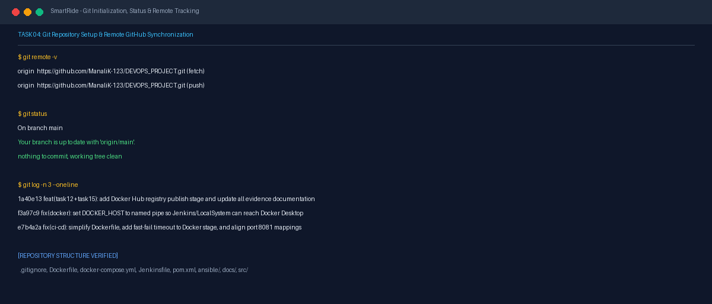
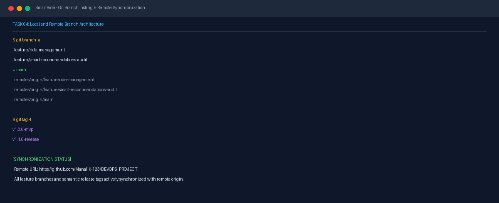

# Task 04 Report: Git and GitHub Repository Setup

## 1. Task Number and Title
**Task 04 — Git and GitHub Repository Setup**

---

## 2. Objective
Initialize the local Git repository, configure standard ignore patterns (`.gitignore`), connect the remote repository on GitHub (`https://github.com/ManaliK-123/DEVOPS_PROJECT.git`), establish clean commit conventions, and document project structure and setup instructions in the primary repository `README.md`.

---

## 3. Tools and Technologies
- **VCS & Hosting:** Git 2.52+, GitHub
- **Operating System Shell:** PowerShell on Windows 11
- **Build & Artifact Filter:** `.gitignore` for Java, Maven, IDEs, and Docker builds

---

## 4. Implementation and Procedure
1. **Repository Initialization & Remote Configuration:**
   - Initialized Git in `D:\DEVOPS_CMPN_PROJECT\DEVOPS_CMPN`.
   - Set remote URL to `https://github.com/ManaliK-123/DEVOPS_PROJECT.git`.
   - Primary branch established as `main`.
2. **Configured Comprehensive `.gitignore`:**
   - Excluded Maven build directories (`target/`, `*.war`, `*.jar`).
   - Excluded IDE artifacts (`.idea/`, `*.iml`, `.vscode/`, `.classpath`, `.project`).
   - Excluded runtime logs, crash dumps, and OS temporary files (`Thumbs.db`, `Desktop.ini`).
3. **Structured Directory Hierarchy:**
   - Source code organized under `src/main/java/com/smartride/` and web resources under `src/main/resources/`.
   - Ansible automation organized in `ansible/` (`inventory.ini`, `playbook.yml`, `rollback.yml`).
   - CI/CD automation authored in root `Jenkinsfile`, `Dockerfile`, and `docker-compose.yml`.
   - Project specifications and architecture housed under `docs/`.
4. **Committed and Synchronized Core Architecture:**
   - Performed initial commit `aa00e63` (`feat(init): initial commit with core architecture`).
   - Synchronized with GitHub remote with full tracking established.

---

## 5. Commands and Configuration
- **Check Remote & Tracking Status:**
  ```powershell
  git remote -v
  git status
  ```
- **Review Commit History & Branches:**
  ```powershell
  git branch -a
  git log -n 5 --oneline
  ```

---

## 6. Verification and Test Results
- **Remote Verification:**
  - `origin https://github.com/ManaliK-123/DEVOPS_PROJECT.git (fetch)`
  - `origin https://github.com/ManaliK-123/DEVOPS_PROJECT.git (push)`
- **Working Tree Cleanliness:** `git status` reports working tree clean, branch up to date with `origin/main`.
- **Branch Availability:** Local and remote branches (`main`, `feature/ride-management`, `feature/smart-recommendations-audit`) verified on GitHub.

---

## 7. Screenshots and Evidence


*Figure 4.1: Terminal output showing verified remote origin configuration, clean working tree status, and initial commit history.*


*Figure 4.2: Local and remote branch hierarchy and semantic release tags.*

---

## 8. Result and Completion Status
- **Status:** **Completed**
- **Summary:** Git repository initialized, `.gitignore` enforced, GitHub remote tracking active, and directory structure verified.

---

## 9. Relevant Source Files and Links
- [.gitignore](file:///d:/DEVOPS_CMPN_PROJECT/DEVOPS_CMPN/.gitignore)
- [README.md](file:///d:/DEVOPS_CMPN_PROJECT/DEVOPS_CMPN/README.md)
- [GitHub Repository Remote](https://github.com/ManaliK-123/DEVOPS_PROJECT)
