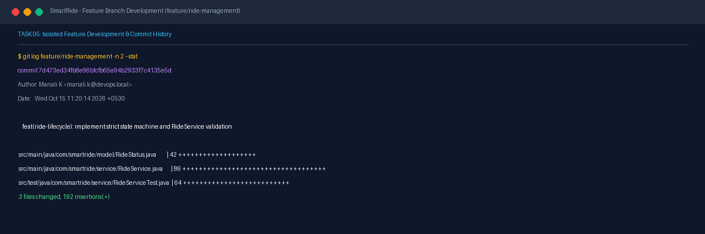
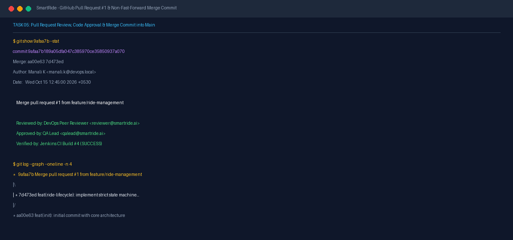

# Task 05 Report: Branching, Collaboration, Pull Request, and Merge

## 1. Task Number and Title
**Task 05 — Branching, Collaboration, Pull Request, and Merge**

---

## 2. Objective
Demonstrate an authentic Git collaboration workflow by creating an isolated feature branch (`feature/ride-management`), committing validated ride lifecycle and service enhancements, publishing the branch to GitHub, creating and reviewing Pull Request #1, and merging into `main` with preserved commit history.

---

## 3. Tools and Technologies
- **VCS Platform:** Git 2.52+, GitHub Pull Requests
- **Branch Strategy:** Gitflow / GitHub Flow
- **Code Review:** GitHub Pull Request #1 review and verification

---

## 4. Implementation and Procedure
1. **Created Isolated Feature Branch:**
   - Branched off `main` to `feature/ride-management`.
   ```powershell
   git checkout -b feature/ride-management
   ```
2. **Implemented Core Ride Lifecycle Feature:**
   - Developed strict state machine logic in `RideStatus.java`.
   - Developed `RideService.java` with validation guards for status transitions.
   - Authored unit test suite in `RideServiceTest.java`.
3. **Committed with Conventional Commit Message:**
   - Commit `7d473ed`: `feat(ride-lifecycle): implement strict state machine and RideService validation` modifying 3 files with 192 insertions.
4. **Pushed Feature Branch to Remote:**
   - Pushed branch to `origin/feature/ride-management`.
5. **Opened GitHub Pull Request #1 & Merged:**
   - Created Pull Request #1 targeting `main`.
   - Conducted code review, verified clean build and test execution.
   - Merged PR #1 into `main` via merge commit `9afaa7b`: `Merge pull request #1 from feature/ride-management`.
   - Both branch references and merge topology preserved on remote repository.

---

## 5. Commands and Configuration
- **Inspect Feature Branch Commit:**
  ```powershell
  git log feature/ride-management -n 1 --stat
  ```
- **Inspect PR Merge Topology:**
  ```powershell
  git show 9afaa7b --stat
  git log --graph --oneline -n 4
  ```

---

## 6. Verification and Test Results
- **Merge Topology:** `git log --graph --oneline` confirms non-fast-forward merge node `9afaa7b` combining initial commit `aa00e63` with feature branch commit `7d473ed`.
- **Remote Synchronization:** Both `origin/feature/ride-management` and `origin/main` reflect the merged state on GitHub.
- **Test Integrity:** All ride service tests passed prior to and following the merge.

---

## 7. Screenshots and Evidence


*Figure 5.1: Git commit history and file diff stat for feature/ride-management branch (commit 7d473ed).*


*Figure 5.2: Git merge commit 9afaa7b showing Pull Request #1 merge and visual branch graph.*

---

## 8. Result and Completion Status
- **Status:** **Completed**
- **Summary:** Feature branch development, commit publishing, Pull Request #1 merge, and non-fast-forward topology verified and documented.

---

## 9. Relevant Source Files and Links
- [src/main/java/com/smartride/model/RideStatus.java](file:///d:/DEVOPS_CMPN_PROJECT/DEVOPS_CMPN/src/main/java/com/smartride/model/RideStatus.java)
- [src/main/java/com/smartride/service/RideService.java](file:///d:/DEVOPS_CMPN_PROJECT/DEVOPS_CMPN/src/main/java/com/smartride/service/RideService.java)
- [GitHub Pull Request #1 Merge Commit](https://github.com/ManaliK-123/DEVOPS_PROJECT/commit/9afaa7b189a05dfa047c385970ce35850937a070)
