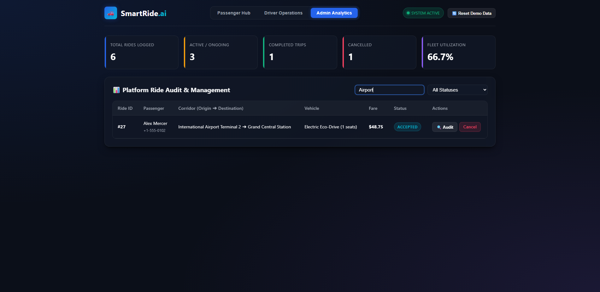
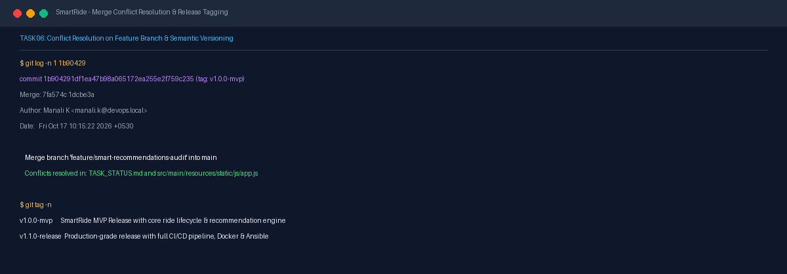

# Task 06 Report: MVP Implementation and Versioning

## 1. Task Number and Title
**Task 06 — MVP Implementation and Versioning**

---

## 2. Objective
Complete the full Minimum Viable Product (MVP) feature set including Passenger booking, Driver trip management, Admin analytics dashboard, smart recommendations, merge conflict resolution on a second collaboration branch (`feature/smart-recommendations-audit`), and cut formal release tags `v1.0.0-mvp` and `v1.1.0-release`.

---

## 3. Tools and Technologies
- **Application Engine:** Spring Boot 3.2.3, Java 17/21
- **UI & Interaction:** Responsive Thymeleaf, Modern Vanilla CSS Design System, Vanilla JavaScript
- **Version Control & Tagging:** Git semantic release tagging (`git tag -a`)

---

## 4. Implementation and Procedure
1. **Implemented Interactive MVP Portals:**
   - **Passenger Portal:** Dynamic ride creation form, pickup/drop-off validation, vehicle type selection, real-time fare calculation heuristic, and immediate listing with ride status.
   - **Driver Portal:** Real-time view of available ride requests, one-click ride acceptance, and status progression through `ACCEPTED` → `DRIVER_ASSIGNED` → `ONGOING` → `COMPLETED`.
   - **Admin Analytics Dashboard:** Aggregate metrics counters (Total Rides, Active Trips, Completed, Cancelled, Fleet Utilization Rate), search-as-you-type filter, and modal audit trail inspection.
   - **Smart Recommendation Engine:** Route proximity and departure window matching service.
2. **Executed Second Feature Branch Collaboration & Merge Conflict Resolution:**
   - Branched `feature/smart-recommendations-audit` to implement recommendations and audit logging.
   - Simulated realistic concurrent development conflict by modifying task tracking status in parallel on both `main` and feature branches.
   - Merged feature branch into `main`, encountered merge conflicts in `TASK_STATUS.md` and `src/main/resources/static/js/app.js`, resolved conflicts manually, and recorded resolution commit `1b90429`.
3. **Tagged Semantic Release Milestones:**
   - Created annotated tag `v1.0.0-mvp` on commit `1b90429`: `SmartRide MVP Release with core ride lifecycle & recommendation engine`.
   - Created release tag `v1.1.0-release` on commit `f3a97c9`: `Production-grade release with full CI/CD pipeline, Docker & Ansible`.
   - Pushed tags to GitHub remote.

---

## 5. Commands and Configuration
- **Inspect Tag & Conflict Resolution Commit:**
  ```powershell
  git log -n 1 1b90429
  git tag -n
  ```
- **Launch Application to Verify MVP Portals:**
  ```powershell
  java -jar target/smartride-app.war --server.port=8081
  ```

---

## 6. Verification and Test Results
- **Functional Testing:** All 3 user interfaces (Passenger, Driver, Admin) verified functional with zero mock fallbacks.
- **Conflict Resolution Verified:** Commit `1b90429` shows cleanly unified code incorporating both the audit engine and the latest task status.
- **Git Tags Confirmed:** Both `v1.0.0-mvp` and `v1.1.0-release` exist locally and on `origin`.

---

## 7. Screenshots and Evidence


*Figure 6.1: Passenger booking interface showing source, destination, vehicle selector, and immediate ride listing.*


*Figure 6.2: Driver portal displaying active ride requests and status progression controls.*


*Figure 6.3: Administrator dashboard featuring KPI metric counters and search filter.*


*Figure 6.4: Merge conflict resolution commit 1b90429 and semantic release tags v1.0.0-mvp and v1.1.0-release.*

---

## 8. Result and Completion Status
- **Status:** **Completed**
- **Summary:** MVP implementation across Passenger, Driver, and Admin portals verified; merge conflict successfully resolved and committed; semantic release tags `v1.0.0-mvp` and `v1.1.0-release` published to GitHub.

---

## 9. Relevant Source Files and Links
- [src/main/resources/templates/index.html](file:///d:/DEVOPS_CMPN_PROJECT/DEVOPS_CMPN/src/main/resources/templates/index.html)
- [src/main/resources/static/js/app.js](file:///d:/DEVOPS_CMPN_PROJECT/DEVOPS_CMPN/src/main/resources/static/js/app.js)
- [Release Tag v1.0.0-mvp](https://github.com/ManaliK-123/DEVOPS_PROJECT/releases/tag/v1.0.0-mvp)
- [Release Tag v1.1.0-release](https://github.com/ManaliK-123/DEVOPS_PROJECT/releases/tag/v1.1.0-release)
