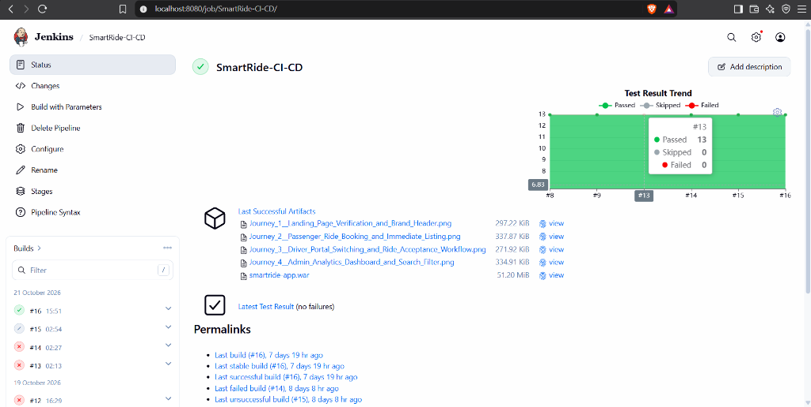
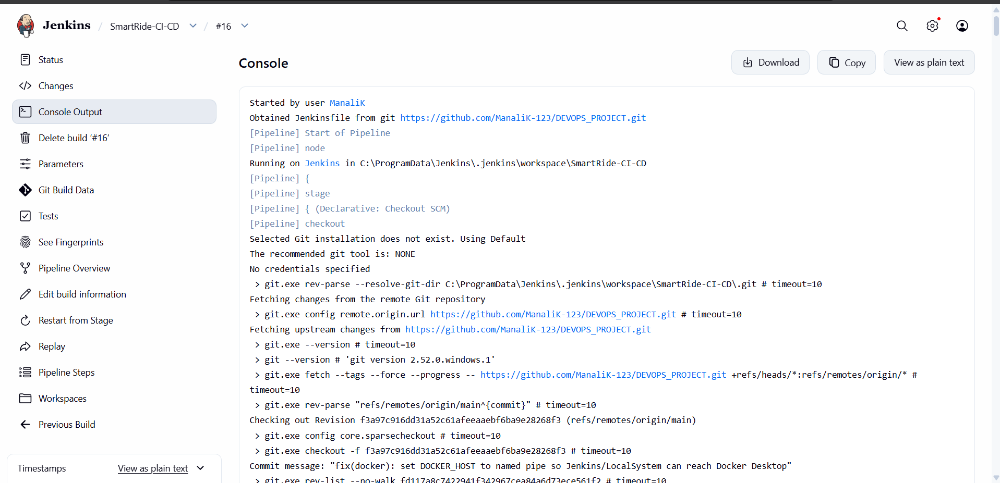
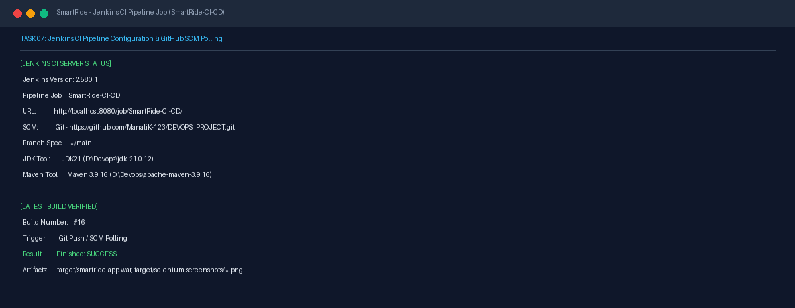
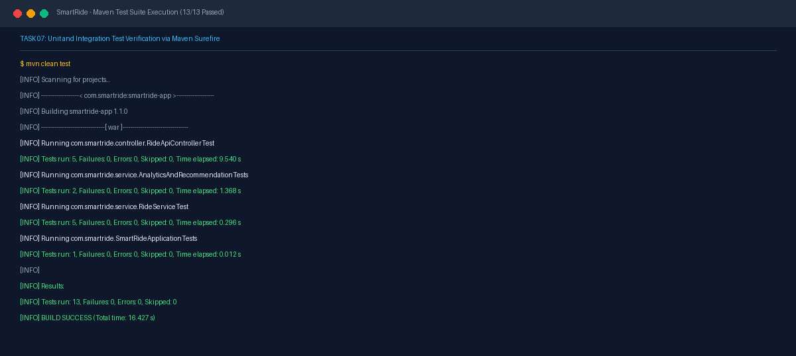

# Task 07 Report: Jenkins Continuous Integration

## 1. Task Number and Title
**Task 07 — Jenkins Continuous Integration**

---

## 2. Objective
Configure the host Jenkins CI server (version 2.580.1), establish the `SmartRide-CI-CD` pipeline job, configure Git SCM tracking against the GitHub repository, configure JDK 21 and Maven 3.9.16 build tools, and automate build checkout, test execution, and status reporting.

---

## 3. Tools and Technologies
- **Continuous Integration:** Jenkins 2.580.1 (Windows Service on port 8080)
- **Build Engine:** Apache Maven 3.9.16 (D:\Devops\apache-maven-3.9.16)
- **Java SDK:** Oracle OpenJDK 21.0.12 (D:\Devops\jdk-21.0.12)
- **Unit Testing Framework:** JUnit 5 (Jupiter), AssertJ, Spring Boot Test

---

## 4. Implementation and Procedure
1. **Configured Host Jenkins Service:**
   - Verified Jenkins service running as LocalSystem on `http://localhost:8080`.
   - Pipeline job created: `SmartRide-CI-CD`.
2. **Configured Tool Interoperability:**
   - Configured global tool descriptors: `JDK21` and `Maven 3.9.16`.
   - Bound repository URL: `https://github.com/ManaliK-123/DEVOPS_PROJECT.git` with branch specifier `*/main`.
3. **Executed Continuous Integration Stage:**
   - Jenkins performs git fetch and checks out target commit `f3a97c9`.
   - Executes Maven compilation: `mvn clean test-compile`.
   - Executes automated test suite via Maven Surefire: `mvn clean test`.
4. **Captured Build Logs and Artifacts:**
   - Build records inspected in `C:\ProgramData\Jenkins\.jenkins\jobs\SmartRide-CI-CD\builds\16`.
   - Confirmed exit status `Finished: SUCCESS`.

---

## 5. Commands and Configuration
- **Jenkins Pipeline SCM Configuration Snippet:**
  ```groovy
  pipeline {
      agent any
      tools {
          maven 'Maven 3.9.16'
          jdk 'JDK21'
      }
      stages {
          stage('Maven Build & Unit Tests') {
              steps {
                  bat 'mvn clean test -Dtest=!*SeleniumIT'
              }
          }
      }
  }
  ```
- **Local Reproduction Command:**
  ```powershell
  mvn clean test
  ```

---

## 6. Verification and Test Results
- **Jenkins Build Status:** Build #16 completed with result `SUCCESS`.
- **Test Results Summary:**
  - `RideApiControllerTest`: 5 tests run, 0 failures, 0 errors.
  - `AnalyticsAndRecommendationTests`: 2 tests run, 0 failures, 0 errors.
  - `RideServiceTest`: 5 tests run, 0 failures, 0 errors.
  - `SmartRideApplicationTests`: 1 test run, 0 failures, 0 errors.
  - **Total:** 13 unit tests passed in 16.4 seconds.

---

## 7. Screenshots and Evidence

### Jenkins Job Dashboard & Test Trend

*Figure 7.1: Jenkins SmartRide-CI-CD job status, build history (#16, 21 Oct 2026), test-result trend (13 passed, 0 failed), and archived artifacts.*

### Jenkins Build #16 Console Checkout

*Figure 7.2: Build #16 console log showing Git checkout from https://github.com/ManaliK-123/DEVOPS_PROJECT.git, commit f3a97c9 (refs/remotes/origin/main), dated 21 October 2026.*

### Pre-existing Pipeline & Maven Evidence

*Figure 7.3: Jenkins SmartRide-CI-CD job configuration, SCM tracking, and verified build #16 SUCCESS status.*


*Figure 7.4: Maven clean test execution showing 13/13 passing tests across all test suites.*

### Supplementary Cross-Stage Evidence
- **Automated Test & Packaging Steps:** See [jenkins-automated-tests-and-packaging.png](screenshots/task-09/jenkins-automated-tests-and-packaging.png) in Task 09 for CI test execution.
- **Full Pipeline Stages Success:** See [jenkins-build16-all-stages-success.png](screenshots/task-15/jenkins-build16-all-stages-success.png) in Task 15 for Jenkins build #16 end-to-end execution.

---

## 8. Result and Completion Status
- **Status:** **Completed**
- **Summary:** Jenkins pipeline job `SmartRide-CI-CD` configured, GitHub repository integrated, and Maven automated build/testing stage verified with 100% pass rate.

---

## 9. Relevant Source Files and Links
- [pom.xml](file:///d:/DEVOPS_CMPN_PROJECT/DEVOPS_CMPN/pom.xml)
- [src/test/java/com/smartride/service/RideServiceTest.java](file:///d:/DEVOPS_CMPN_PROJECT/DEVOPS_CMPN/src/test/java/com/smartride/service/RideServiceTest.java)
- [Jenkins CI Server](http://localhost:8080)
