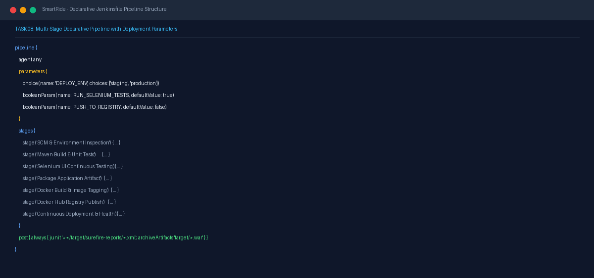
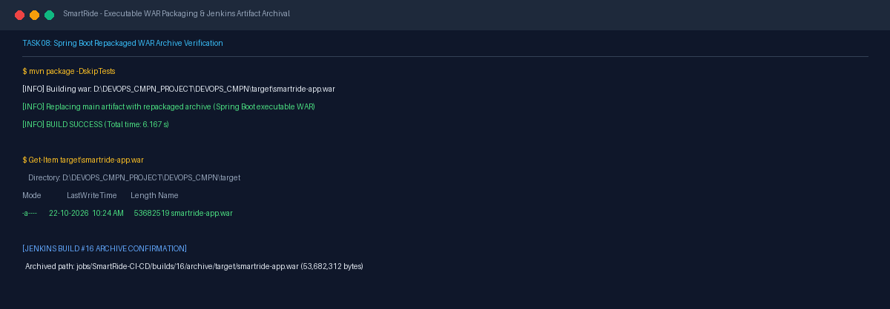

# Task 08 Report: Jenkins Pipeline and Deployment Parameters

## 1. Task Number and Title
**Task 08 — Jenkins Pipeline and Deployment Parameters**

---

## 2. Objective
Author and version a declarative `Jenkinsfile` (Pipeline as Code) with parameterized execution options (`DEPLOY_ENV`, `RUN_SELENIUM_TESTS`, `PUSH_TO_REGISTRY`), automate packaging into an executable Spring Boot WAR archive, archive build artifacts, and establish post-build test recording.

---

## 3. Tools and Technologies
- **Pipeline as Code:** Declarative Jenkinsfile (Groovy DSL)
- **Archive Packaging:** Maven WAR Plugin, Spring Boot Maven Plugin
- **Artifact Archiving:** Jenkins `archiveArtifacts` and `junit` post-build steps

---

## 4. Implementation and Procedure
1. **Authored Declarative Pipeline as Code:**
   - Authored [Jenkinsfile](file:///d:/DEVOPS_CMPN_PROJECT/DEVOPS_CMPN/Jenkinsfile) at repository root.
   - Defined parameters block:
     - `DEPLOY_ENV`: Choice parameter (`staging`, `production`).
     - `RUN_SELENIUM_TESTS`: Boolean flag (default `true`).
     - `PUSH_TO_REGISTRY`: Boolean flag (default `false`).
2. **Integrated Sequential Pipeline Stages:**
   - Stage 1: `SCM & Environment Inspection` (logs git commit, tools, environment variables).
   - Stage 2: `Maven Build & Unit Tests` (compiles and runs unit test suite).
   - Stage 3: `Selenium UI Continuous Testing` (runs headless browser tests).
   - Stage 4: `Package Application Artifact` (`mvn package -DskipTests`).
   - Stage 5: `Docker Build & Image Tagging` (builds `smartride-app:1.1.0`).
   - Stage 6: `Docker Hub Registry Publish` (conditional stage with credentials).
   - Stage 7: `Continuous Deployment & Health Probe` (spins up container and polls `/actuator/health`).
3. **Configured Artifact Archival & Post Actions:**
   - Configured `archiveArtifacts 'target/*.war'` to preserve `smartride-app.war`.
   - Configured `junit '**/target/surefire-reports/*.xml'` to publish test metrics.
   - Configured `archiveArtifacts 'target/selenium-screenshots/*.png'` to save UI test evidence.

---

## 5. Commands and Configuration
- **Jenkinsfile Configuration Excerpt:**
  ```groovy
  parameters {
      choice(name: 'DEPLOY_ENV', choices: ['staging', 'production'], description: 'Deployment environment target')
      booleanParam(name: 'RUN_SELENIUM_TESTS', defaultValue: true, description: 'Execute Selenium WebDriver UI tests')
      booleanParam(name: 'PUSH_TO_REGISTRY', defaultValue: false, description: 'Push built image to Docker Hub')
  }
  stages {
      stage('Package Application Artifact') {
          steps {
              bat 'mvn package -DskipTests'
          }
      }
  }
  post {
      always {
          junit allowEmptyResults: true, testResults: '**/target/surefire-reports/*.xml'
          archiveArtifacts allowEmptyArchive: true, artifacts: 'target/*.war, target/selenium-screenshots/*.png'
      }
  }
  ```
- **Local WAR Packaging Verification:**
  ```powershell
  mvn package -DskipTests
  Get-Item target\smartride-app.war
  ```

---

## 6. Verification and Test Results
- **WAR Packaging Success:** `smartride-app.war` built successfully (size: 53,682,519 bytes / ~51.2 MB).
- **Repackaging:** Spring Boot Maven plugin replaced main artifact with executable archive containing embedded Tomcat and all runtime dependencies.
- **Jenkins Archival Verified:** Jenkins build #16 archived `target/smartride-app.war` in `C:\ProgramData\Jenkins\.jenkins\jobs\SmartRide-CI-CD\builds\16\archive\target\smartride-app.war`.

---

## 7. Screenshots and Evidence


*Figure 8.1: Declarative Jenkinsfile pipeline definition showing build parameters, sequential stages, and post actions.*


*Figure 8.2: Executable WAR archive packaging verification and Jenkins build #16 artifact archival confirmation.*

---

## 8. Result and Completion Status
- **Status:** **Completed**
- **Summary:** Declarative `Jenkinsfile` authored, parameterized execution implemented, executable WAR packaged, and Jenkins artifact archival verified.

---

## 9. Relevant Source Files and Links
- [Jenkinsfile](file:///d:/DEVOPS_CMPN_PROJECT/DEVOPS_CMPN/Jenkinsfile)
- [pom.xml](file:///d:/DEVOPS_CMPN_PROJECT/DEVOPS_CMPN/pom.xml)
- [Jenkins Job SmartRide-CI-CD](http://localhost:8080/job/SmartRide-CI-CD/)
