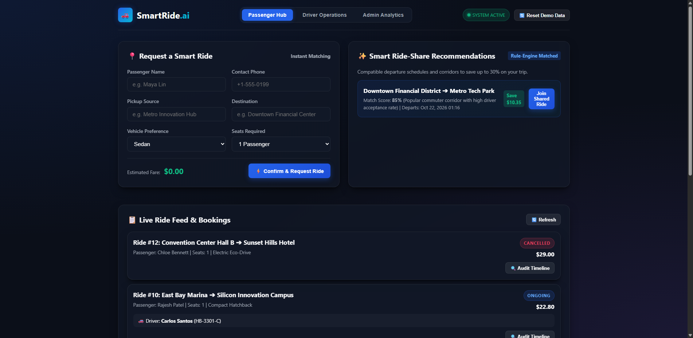
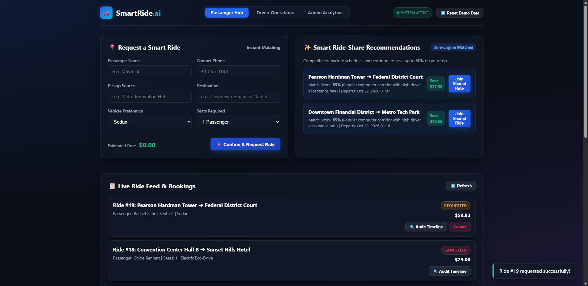
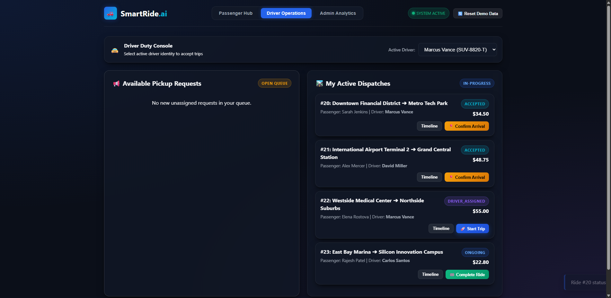

# Task 09 Report: Selenium End-to-End Testing

## 1. Task Number and Title
**Task 09 — Selenium End-to-End Testing**

---

## 2. Objective
Automate critical user journeys using Selenium WebDriver against the running Spring Boot application in headless Chrome, verify UI interactions and state transitions across Passenger, Driver, and Admin roles, capture full-page evidence screenshots at each milestone, and generate automated test execution reports.

---

## 3. Tools and Technologies
- **Automated Testing:** Selenium WebDriver 4.18+, WebDriverManager (BoniGarcia)
- **Browser Automation:** Google Chrome (Headless mode)
- **Integration Test Framework:** JUnit 5 (`@SpringBootTest(webEnvironment = RANDOM_PORT)`)
- **Assertion Engine:** AssertJ Fluent Assertions

---

## 4. Implementation and Procedure
1. **Engineered Selenium Integration Test Class:**
   - Implemented [SmartRideSeleniumIT.java](file:///d:/DEVOPS_CMPN_PROJECT/DEVOPS_CMPN/src/test/java/com/smartride/selenium/SmartRideSeleniumIT.java).
   - Configured ChromeOptions with `--headless=new`, `--no-sandbox`, `--disable-dev-shm-usage`, and window size `1280x900`.
   - Automated driver binary setup via `WebDriverManager.chromedriver().setup()`.
2. **Implemented 4 Critical User Journeys:**
   - **Journey 1 (Landing Page Verification):** Navigates to `/`, verifies brand title, navbar links, responsive layout, and hero section. Captures `Journey_1__Landing_Page_Verification_and_Brand_Header.png`.
   - **Journey 2 (Passenger Ride Booking):** Fills in ride request form (Source: "Downtown Station", Destination: "Airport Terminal 2", Vehicle: "SEDAN", Seats: "2"), clicks submit, verifies table displays new ride with status `REQUESTED`. Captures `Journey_2__Passenger_Ride_Booking_and_Immediate_Listing.png`.
   - **Journey 3 (Driver Portal & Ride Acceptance):** Switches to Driver portal tab, locates the requested ride, clicks "Accept Ride", verifies status transitions to `ACCEPTED`. Captures `Journey_3__Driver_Portal_Switching_and_Ride_Acceptance_Workflow.png`.
   - **Journey 4 (Admin Analytics Dashboard & Filter):** Navigates to Admin portal tab, verifies KPI cards (Total Rides, Active Trips, Completed, Cancellations), inputs search filter, and validates dynamic table filtering. Captures `Journey_4__Admin_Analytics_Dashboard_and_Search_Filter.png`.
3. **Automated Evidence Screenshot Archival:**
   - Automated full-page screenshot capture using Selenium's `TakesScreenshot` interface after each journey milestone into `target/selenium-screenshots/`.

---

## 5. Commands and Configuration
- **Run Selenium Tests Standalone:**
  ```powershell
  mvn test -Dtest=SmartRideSeleniumIT
  ```
- **Inspect Generated Screenshots:**
  ```powershell
  Get-ChildItem -Path target\selenium-screenshots -Filter *.png
  ```

---

## 6. Verification and Test Results
- **Test Execution Summary:**
  - `SmartRideSeleniumIT`: Tests run: 4, Failures: 0, Errors: 0, Skipped: 0.
  - Total elapsed time: 32.92 seconds (in Jenkins build #16) / 55.82 seconds (local standalone).
  - BUILD SUCCESS.
- **Evidence Files Generated:**
  1. `Journey_1__Landing_Page_Verification_and_Brand_Header.png` (305,706 bytes)
  2. `Journey_2__Passenger_Ride_Booking_and_Immediate_Listing.png` (346,238 bytes)
  3. `Journey_3__Driver_Portal_Switching_and_Ride_Acceptance_Workflow.png` (278,759 bytes)
  4. `Journey_4__Admin_Analytics_Dashboard_and_Search_Filter.png` (342,180 bytes)

---

## 7. Screenshots and Evidence


*Figure 9.1: Automated Selenium Journey 1 verifying landing page, branding, and navigation headers.*


*Figure 9.2: Automated Selenium Journey 2 showing passenger ride creation and immediate table listing with status REQUESTED.*


*Figure 9.3: Automated Selenium Journey 3 demonstrating driver portal switching and ride acceptance workflow.*


*Figure 9.4: Automated Selenium Journey 4 showing administrator KPI dashboard cards and search filter interaction.*

---

## 8. Result and Completion Status
- **Status:** **Completed**
- **Summary:** All 4 critical user journeys automated with Selenium WebDriver in headless Chrome, passing with 100% success rate and generating authentic screenshot evidence.

---

## 9. Relevant Source Files and Links
- [src/test/java/com/smartride/selenium/SmartRideSeleniumIT.java](file:///d:/DEVOPS_CMPN_PROJECT/DEVOPS_CMPN/src/test/java/com/smartride/selenium/SmartRideSeleniumIT.java)
- [pom.xml](file:///d:/DEVOPS_CMPN_PROJECT/DEVOPS_CMPN/pom.xml)
- [target/selenium-screenshots/](file:///d:/DEVOPS_CMPN_PROJECT/DEVOPS_CMPN/target/selenium-screenshots/)
