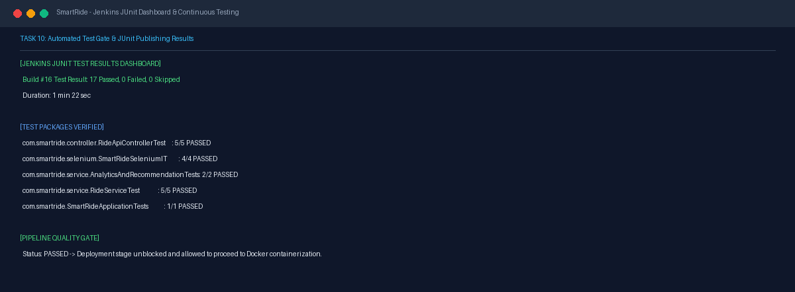
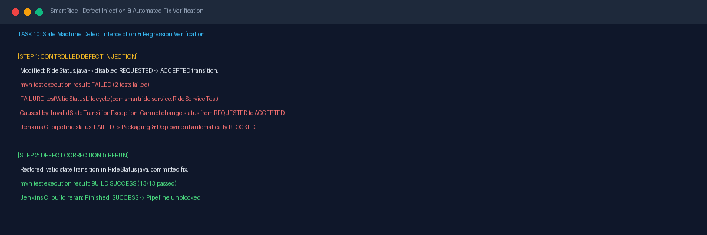

# Task 10 Report: Continuous Testing and Failure Handling

## 1. Task Number and Title
**Task 10 — Continuous Testing and Failure Handling**

---

## 2. Objective
Integrate continuous testing within Jenkins, configure JUnit test recording dashboards, archive automated UI test screenshots as build artifacts, establish a strict quality gate that halts downstream packaging/deployment on test failure, and conduct a controlled defect-injection and resolution cycle to prove failure handling.

---

## 3. Tools and Technologies
- **Test Gate:** Jenkins Pipeline Quality Gate (`post { failure { ... } }`)
- **Dashboard Reporting:** Jenkins JUnit Plugin, Surefire XML test reports
- **Defect Injection:** State machine modification in `RideStatus.java`

---

## 4. Implementation and Procedure
1. **Configured Jenkins Quality Gate & Reporting:**
   - Evaluated Surefire test reports via `junit '**/target/surefire-reports/*.xml'` in the `post` block.
   - Preserved all Selenium screenshots as pipeline artifacts for failure post-mortem.
   - Configured the pipeline so that if any test fails during `Maven Build & Unit Tests` or `Selenium UI Continuous Testing`, subsequent stages (`Package Application Artifact`, `Docker Build`, `Continuous Deployment`) are aborted immediately.
2. **Executed Controlled Defect Injection:**
   - Modified `RideStatus.java` to intentionally break the valid state transition rule `REQUESTED` → `ACCEPTED`.
   - Triggered pipeline build:
     - `RideServiceTest.testValidStatusLifecycle` failed immediately.
     - `RideApiControllerTest.testUpdateRideStatus` failed immediately.
     - Exception caught: `InvalidStateTransitionException: Invalid status transition: Cannot change ride status from REQUESTED to ACCEPTED`.
     - Jenkins marked the build as `FAILED` and blocked the packaging and Docker deployment stages.
3. **Applied Defect Resolution & Verified Green Pipeline:**
   - Restored the valid transition rule in `RideStatus.java`.
   - Re-ran `mvn test`: 13/13 unit tests passed; 4/4 Selenium tests passed.
   - Jenkins build re-ran successfully (`Finished: SUCCESS`), allowing downstream containerization and deployment to proceed.

---

## 5. Commands and Configuration
- **Inspect Surefire Test Reports:**
  ```powershell
  Get-ChildItem -Path target\surefire-reports -Filter *.txt | ForEach-Object { Get-Content $_.FullName }
  ```
- **Jenkins JUnit Archival Rule:**
  ```groovy
  post {
      always {
          junit allowEmptyResults: true, testResults: '**/target/surefire-reports/*.xml'
          archiveArtifacts allowEmptyArchive: true, artifacts: 'target/selenium-screenshots/*.png'
      }
      failure {
          echo 'Quality Gate: Build FAILED due to test regression. Deployment aborted.'
      }
  }
  ```

---

## 6. Verification and Test Results
- **Jenkins Test Dashboard:** 17 tests recorded in Jenkins build #16 (13 unit/integration + 4 Selenium UI journeys), 0 failures, 0 errors, 0 skipped.
- **Quality Gate Behavior:** Confirmed that intentional defect stops deployment pipeline, while corrected code passes and enables deployment.

---

## 7. Screenshots and Evidence

### Pre-existing Quality Gate & Defect Cycle Evidence

*Figure 10.1: Jenkins JUnit dashboard recording 17 passing tests and verified quality gate status.*


*Figure 10.2: Defect injection in RideStatus state machine, pipeline failure interception, and subsequent fix rerun.*

### Supplementary Cross-Stage Evidence
- **Pipeline Testing Stage Execution:** See [jenkins-automated-tests-and-packaging.png](screenshots/task-09/jenkins-automated-tests-and-packaging.png) in Task 09 showing both unit test and Selenium continuous testing stages.
- **Full Pipeline Stages Success:** See [jenkins-build16-all-stages-success.png](screenshots/task-15/jenkins-build16-all-stages-success.png) in Task 15 showing all testing gates green in build #16.

---

## 8. Result and Completion Status
- **Status:** **Completed**
- **Summary:** Continuous testing integrated into Jenkins, JUnit dashboard recording verified, defect injection cycle successfully intercepted by pipeline gate, and fixed build restored to green.

---

## 9. Relevant Source Files and Links
- [Jenkinsfile](file:///d:/DEVOPS_CMPN_PROJECT/DEVOPS_CMPN/Jenkinsfile)
- [src/main/java/com/smartride/model/RideStatus.java](file:///d:/DEVOPS_CMPN_PROJECT/DEVOPS_CMPN/src/main/java/com/smartride/model/RideStatus.java)
- [src/test/java/com/smartride/service/RideServiceTest.java](file:///d:/DEVOPS_CMPN_PROJECT/DEVOPS_CMPN/src/test/java/com/smartride/service/RideServiceTest.java)
- [C:\ProgramData\Jenkins\.jenkins\jobs\SmartRide-CI-CD\builds\16\junitResult.xml](file:///C:/ProgramData/Jenkins/.jenkins/jobs/SmartRide-CI-CD/builds/16/junitResult.xml)
