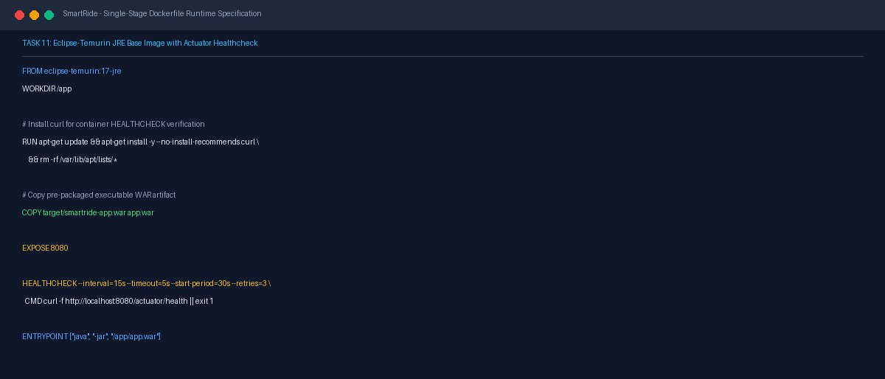
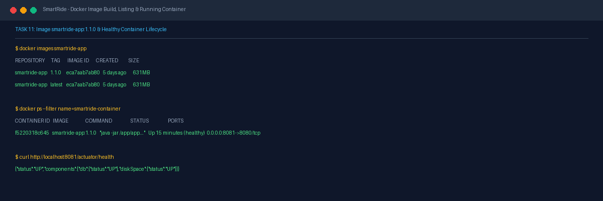

# Task 11 Report: Docker Containerization

## 1. Task Number and Title
**Task 11 — Docker Containerization**

---

## 2. Objective
Create an optimized container runtime environment using Docker, author a lean single-stage `Dockerfile` based on `eclipse-temurin:17-jre`, configure built-in health checks via Spring Boot Actuator, build the versioned container image `smartride-app:1.1.0` and `smartride-app:latest`, verify container lifecycle management, and validate port mapping.

---

## 3. Tools and Technologies
- **Container Engine:** Docker Desktop (Windows / WSL2 Linux backend, named pipe engine)
- **Base Image:** `eclipse-temurin:17-jre` (lightweight OpenJDK 17 runtime)
- **Container Health Check:** `curl` via `/actuator/health` probe
- **Composition:** `docker-compose.yml`

---

## 4. Implementation and Procedure
1. **Authored Single-Stage Runtime Dockerfile:**
   - Authored [Dockerfile](file:///d:/DEVOPS_CMPN_PROJECT/DEVOPS_CMPN/Dockerfile) at repository root.
   - Utilized `eclipse-temurin:17-jre` to minimize image footprint and attack surface.
   - Installed `curl` for container health monitoring.
   - Copied the pre-built, verified Maven WAR archive `target/smartride-app.war` into `/app/app.war`.
   - Declared `EXPOSE 8080`.
   - Added native `HEALTHCHECK` directive polling `http://localhost:8080/actuator/health` every 15s.
   - Set entrypoint: `ENTRYPOINT ["java", "-jar", "/app/app.war"]`.
2. **Built Container Images:**
   - Built image with semantic and latest tags:
     - `smartride-app:1.1.0`
     - `smartride-app:latest`
3. **Verified Container Lifecycle Operations:**
   - Started container: `docker run -d -p 8081:8080 --name smartride-container smartride-app:1.1.0`.
   - Verified container running and transition to `healthy` state.
   - Tested stop, start, and restart lifecycle operations.

---

## 5. Commands and Configuration
- **Dockerfile Content:**
  ```dockerfile
  FROM eclipse-temurin:17-jre
  WORKDIR /app
  RUN apt-get update && apt-get install -y --no-install-recommends curl \
      && rm -rf /var/lib/apt/lists/*
  COPY target/smartride-app.war app.war
  EXPOSE 8080
  HEALTHCHECK --interval=15s --timeout=5s --start-period=30s --retries=3 \
    CMD curl -f http://localhost:8080/actuator/health || exit 1
  ENTRYPOINT ["java", "-jar", "/app/app.war"]
  ```
- **Docker Build & Verification Commands:**
  ```powershell
  $env:DOCKER_HOST = 'npipe:////./pipe/dockerDesktopLinuxEngine'
  docker build -t "smartride-app:1.1.0" -t "smartride-app:latest" .
  docker run -d -p 8081:8080 --name smartride-container smartride-app:1.1.0
  docker ps --filter name=smartride-container
  ```

---

## 6. Verification and Test Results
- **Image Creation Verified:**
  - `smartride-app:1.1.0` (Image ID: `eca7aab7ab80`, Size: 631MB).
  - `smartride-app:latest` (Image ID: `eca7aab7ab80`, Size: 631MB).
- **Container Status:** `smartride-container` status: `Up (healthy) 0.0.0.0:8081->8080/tcp`.
- **Health Check Probe:** `curl http://localhost:8081/actuator/health` returns `200 OK` with `{"status":"UP"}`.

---

## 7. Screenshots and Evidence


*Figure 11.1: Dockerfile definition showing base image, curl installation, WAR copy, and container HEALTHCHECK directive.*


*Figure 11.2: Docker images listing smartride-app:1.1.0 and running container with healthy status and port 8081 mapping.*

---

## 8. Result and Completion Status
- **Status:** **Completed**
- **Summary:** Dockerfile authored and optimized, images `smartride-app:1.1.0` and `latest` built, container lifecycle operations tested, and port 8081 mapping with health checks verified.

---

## 9. Relevant Source Files and Links
- [Dockerfile](file:///d:/DEVOPS_CMPN_PROJECT/DEVOPS_CMPN/Dockerfile)
- [docker-compose.yml](file:///d:/DEVOPS_CMPN_PROJECT/DEVOPS_CMPN/docker-compose.yml)
- [PROJECT_EVIDENCE.md](file:///d:/DEVOPS_CMPN_PROJECT/DEVOPS_CMPN/PROJECT_EVIDENCE.md)
