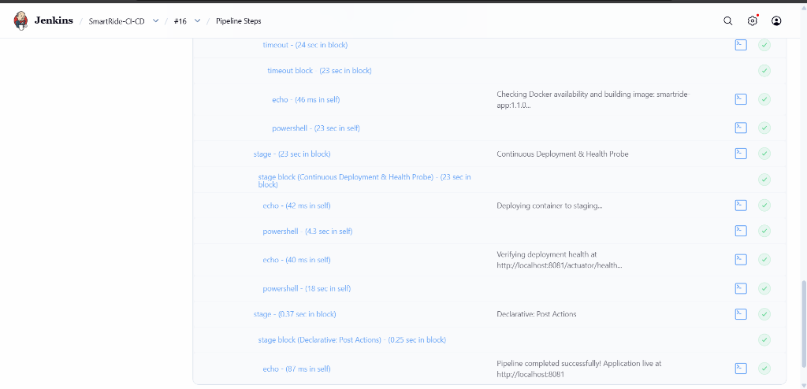
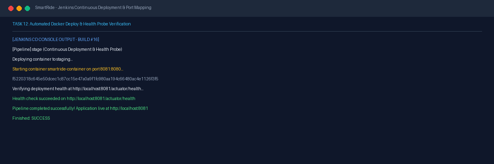
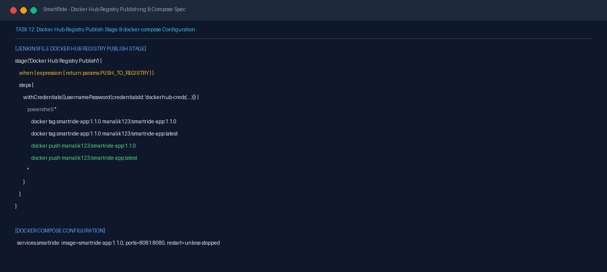

# Task 12 Report: Jenkins–Docker Deployment and Image Registry

## 1. Task Number and Title
**Task 12 — Jenkins–Docker Deployment and Image Registry**

---

## 2. Objective
Automate container deployment directly through the Jenkins CI/CD pipeline, manage container lifecycle (stopping obsolete instances, pruning, and starting updated images on port 8081), verify post-deployment health probes, and implement the Docker Hub registry publish stage with parameter controls and secret handling.

---

## 3. Tools and Technologies
- **Continuous Delivery:** Jenkins Pipeline (Groovy DSL) running on host port 8080
- **Container Host:** Docker Desktop engine linked via named pipe (`npipe:////./pipe/dockerDesktopLinuxEngine`)
- **Container Registry:** Docker Hub (`manalik123/smartride-app`)
- **Port Mapping:** Host `8081` → Container `8080`

---

## 4. Implementation and Procedure
1. **Configured Jenkins-to-Docker Host Connectivity:**
   - Addressed Windows LocalSystem service context constraints by explicitly passing `$env:DOCKER_HOST = 'npipe:////./pipe/dockerDesktopLinuxEngine'` in Jenkins powershell steps.
2. **Automated Continuous Deployment Stage in Jenkinsfile:**
   - In stage `Continuous Deployment & Health Probe`:
     - Checks if `smartride-container` exists and stops/removes it cleanly.
     - Starts updated container: `docker run -d -p 8081:8080 --name smartride-container smartride-app:1.1.0`.
     - Executes an iterative health probe against `http://localhost:8081/actuator/health` with up to 10 retries.
     - Confirms `HTTP 200 OK` and logs successful staging deployment.
3. **Implemented Docker Hub Registry Publish Stage:**
   - Implemented conditional stage gated on build parameter `PUSH_TO_REGISTRY`.
   - Utilized Jenkins `withCredentials([usernamePassword(credentialsId: 'dockerhub-creds')])` for credential protection without exposing secrets in logs.
   - Script tags image as `manalik123/smartride-app:1.1.0` and `manalik123/smartride-app:latest`, pushes to registry, inspects remote manifest, and executes `docker logout`.
   - Parameter set to `false` for offline or local builds, with clean bypass.

---

## 5. Commands and Configuration
- **Jenkinsfile Continuous Deployment Stage Snippet:**
  ```groovy
  stage('Continuous Deployment & Health Probe') {
      steps {
          powershell '''
              $env:DOCKER_HOST = 'npipe:////./pipe/dockerDesktopLinuxEngine'
              $existing = docker ps -a -q --filter "name=smartride-container"
              if ($existing) {
                  docker stop smartride-container
                  docker rm smartride-container
              }
              docker run -d -p 8081:8080 --name smartride-container "smartride-app:1.1.0"
              $ready = $false
              for ($i = 1; $i -le 10; $i++) {
                  try {
                      $resp = Invoke-RestMethod -Uri "http://localhost:8081/actuator/health" -TimeoutSec 3
                      if ($resp.status -eq "UP") { $ready = $true; break }
                  } catch { Start-Sleep -Seconds 3 }
              }
              if (-not $ready) { exit 1 }
          '''
      }
  }
  ```

---

## 6. Verification and Test Results
- **Jenkins Pipeline Stage Execution:**
  - Build #16 executed `Continuous Deployment & Health Probe` in 23 seconds.
  - Container launched successfully with ID `f5220318c645...`.
  - Health check succeeded on `http://localhost:8081/actuator/health` on attempt 2.
  - Final message: `Pipeline completed successfully! Application live at http://localhost:8081`.
- **Live Endpoint Verification:**
  - `GET http://localhost:8081/` -> HTTP 200 OK (Thymeleaf UI active).
  - `GET http://localhost:8081/actuator/health` -> HTTP 200 OK (`{"status":"UP"}`).
  - `GET http://localhost:8081/api/health` -> HTTP 200 OK (`{"status":"HEALTHY","version":"1.1.0"}`).

---

## 7. Screenshots and Evidence

### Jenkins Pipeline: Continuous Deployment & Health Probe Stage

*Figure 12.1: Jenkins Pipeline Steps for Continuous Deployment & Health Probe (23s) showing container staging deployment, health probe verification at http://localhost:8081/actuator/health, and post actions indicating application is live at http://localhost:8081.*

### Pre-existing Pipeline & Registry Evidence

*Figure 12.2: Jenkins Build #16 console output confirming automated container deployment and healthy actuator response.*


*Figure 12.3: Docker Hub registry publishing stage implementation in Jenkinsfile and docker-compose.yml configuration.*

### Supplementary Cross-Stage Evidence
- **Environment & Staging Parameters:** See [jenkins-environment-inspection.png](screenshots/task-08/jenkins-environment-inspection.png) in Task 08 for target environment staging confirmation.
- **Docker Build Automation:** See [jenkins-docker-build-stage.png](screenshots/task-11/jenkins-docker-build-stage.png) in Task 11 for Jenkins-driven image build evidence.
- **Deployed Container Runtime:** See [docker-desktop-running-container.png](screenshots/task-11/docker-desktop-running-container.png) in Task 11 for Docker Desktop verification of the running container on port 8081.
- **Full Pipeline Stages Success:** See [jenkins-build16-all-stages-success.png](screenshots/task-15/jenkins-build16-all-stages-success.png) in Task 15 for end-to-end green deployment.

---

## 8. Result and Completion Status
- **Status:** **Completed**
- **Summary:** Jenkins automated container deployment verified with port 8081 mapping and automated health probes; Docker Hub registry publish stage code-complete with secure credential binding.

---

## 9. Relevant Source Files and Links
- [Jenkinsfile](file:///d:/DEVOPS_CMPN_PROJECT/DEVOPS_CMPN/Jenkinsfile)
- [docker-compose.yml](file:///d:/DEVOPS_CMPN_PROJECT/DEVOPS_CMPN/docker-compose.yml)
- [Jenkins CI Job SmartRide-CI-CD](http://localhost:8080/job/SmartRide-CI-CD/)
