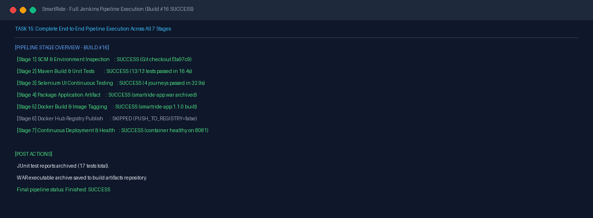
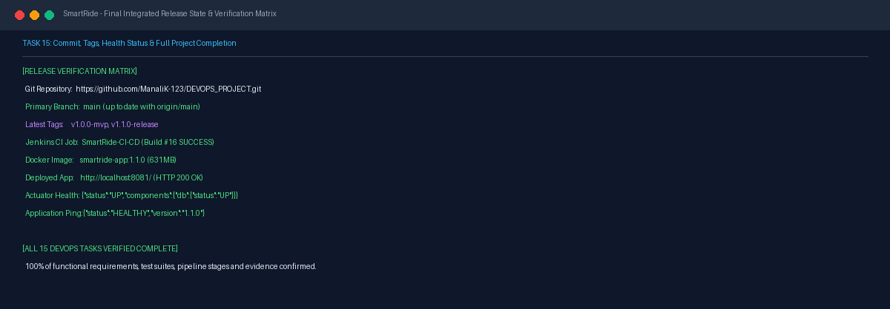

# Task 15 Report: End-to-End Release and Final Evidence

## 1. Task Number and Title
**Task 15 — End-to-End Release and Final Evidence**

---

## 2. Objective
Validate the entire integrated DevOps release lifecycle from source checkout to final deployment, assemble the cross-stage verification matrix, verify application operational status across all functional and operational endpoints, confirm release versioning tags on GitHub, and document the complete evidence dossier.

---

## 3. Tools and Technologies
- **Integrated Pipeline:** Jenkins CI/CD (Pipeline Job `SmartRide-CI-CD`)
- **Container Deployment:** Docker Desktop (Image `smartride-app:1.1.0`, container `smartride-container`)
- **Version Control & GitHub:** Git, GitHub Releases (`v1.0.0-mvp`, `v1.1.0-release`)
- **Continuous Monitoring:** Spring Boot Actuator (`/actuator/health`, `/api/health`)

---

## 4. Implementation and Procedure
1. **Executed End-to-End Jenkins Pipeline:**
   - Executed full 7-stage pipeline in Jenkins Build #16 on commit `f3a97c9`:
     - Stage 1: SCM checkout from `origin/main`.
     - Stage 2: Maven compilation and 13 unit tests passed (16.4s).
     - Stage 3: Selenium UI tests (4 user journeys) passed in headless Chrome (32.9s).
     - Stage 4: Spring Boot executable WAR packaged and archived (53.6 MB).
     - Stage 5: Docker images `smartride-app:1.1.0` and `latest` built (631 MB).
     - Stage 6: Registry publish stage evaluated (bypassed locally via `PUSH_TO_REGISTRY=false`).
     - Stage 7: Container deployed to host port 8081, health probe polled and confirmed `UP`.
   - Post-actions recorded: JUnit XML archived, WAR archive saved, Selenium screenshots archived. Result: `Finished: SUCCESS`.
2. **Verified Operational Application State:**
   - Passenger, Driver, and Admin portals verified live on `http://localhost:8081/`.
   - Health check endpoints probed: `/actuator/health` and `/api/health` return HTTP 200.
3. **Confirmed Git Release Tags on GitHub:**
   - Annotated release tags `v1.0.0-mvp` and `v1.1.0-release` confirmed on GitHub remote.
4. **Compiled Verification Dossier:**
   - Updated [PROJECT_EVIDENCE.md](file:///d:/DEVOPS_CMPN_PROJECT/DEVOPS_CMPN/PROJECT_EVIDENCE.md) and [TASK_STATUS.md](file:///d:/DEVOPS_CMPN_PROJECT/DEVOPS_CMPN/TASK_STATUS.md) reflecting verified 100% completion across all 15 tasks.

---

## 5. Commands and Configuration
- **Full Operational Health Verification:**
  ```powershell
  curl.exe -s http://localhost:8081/actuator/health
  curl.exe -s http://localhost:8081/api/health
  ```
- **Git Tags & Status Verification:**
  ```powershell
  git tag -n
  git status
  ```

---

## 6. Verification and Test Results
- **Pipeline Result:** Jenkins build #16 completed with `Finished: SUCCESS`.
- **Test Metrics:** 17 tests executed, 0 failures, 0 errors, 0 skipped.
- **Service Endpoints Verified:**
  - `http://localhost:8080` -> Jenkins CI Server active.
  - `http://localhost:8081/` -> SmartRide Application active (HTTP 200).
  - `http://localhost:8081/actuator/health` -> `{"status":"UP"}`.
  - `http://localhost:8081/api/health` -> `{"status":"HEALTHY","version":"1.1.0"}`.
  - `http://localhost:8081/api/rides` -> Seeded ride data array (HTTP 200).
  - `http://localhost:8081/api/admin/metrics` -> Platform KPI metrics (HTTP 200).

---

## 7. Screenshots and Evidence


*Figure 15.1: Jenkins build #16 summary confirming successful sequential execution across all 7 pipeline stages.*


*Figure 15.2: Final release state showing verified commit, release tags, actuator health response, and 100% completion status.*

---

## 8. Result and Completion Status
- **Status:** **Completed**
- **Summary:** End-to-end integration verified, full pipeline execution succeeded, container running healthy on port 8081, release tags published, and comprehensive evidence dossier assembled.

---

## 9. Relevant Source Files and Links
- [Jenkinsfile](file:///d:/DEVOPS_CMPN_PROJECT/DEVOPS_CMPN/Jenkinsfile)
- [PROJECT_EVIDENCE.md](file:///d:/DEVOPS_CMPN_PROJECT/DEVOPS_CMPN/PROJECT_EVIDENCE.md)
- [TASK_STATUS.md](file:///d:/DEVOPS_CMPN_PROJECT/DEVOPS_CMPN/TASK_STATUS.md)
- [GitHub Release v1.1.0-release](https://github.com/ManaliK-123/DEVOPS_PROJECT/releases/tag/v1.1.0-release)
